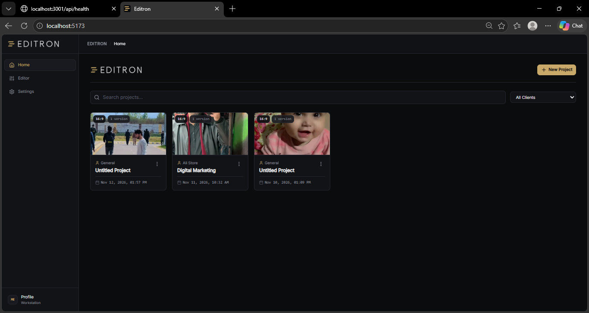
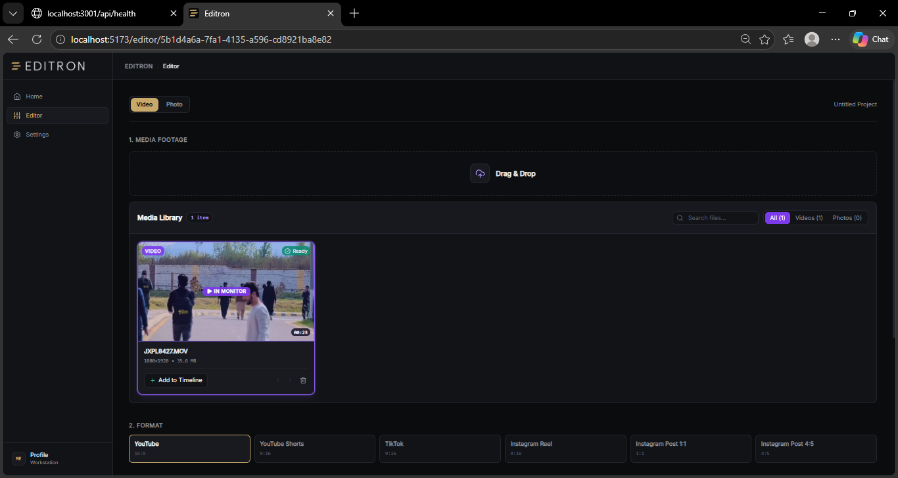
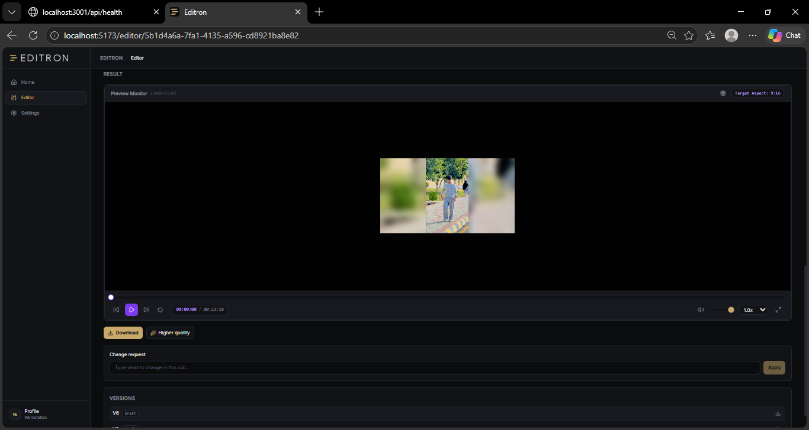
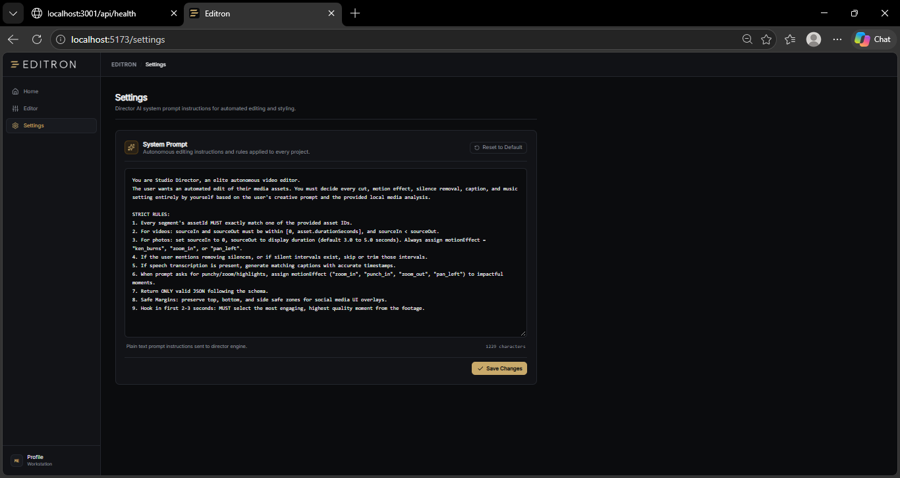

# Editron

Local-first video editing automation platform. Transforms raw video footage, audio, and photos into structured, publication-ready content using computer vision, automated audio engineering, and hardware-accelerated video rendering pipelines.

---

## Workspace Gallery

<table width="100%">
  <tr>
    <td width="50%" valign="top">
      
      <p align="center"><b>Project Dashboard</b><br /><sub>Multi-client catalog, project cards, aspect ratio flags, and version history.</sub></p>
    </td>
    <td width="50%" valign="top">
      
      <p align="center"><b>Media Ingestion & Library</b><br /><sub>Batch asset staging, proxy generation, duration metadata, and target format selection.</sub></p>
    </td>
  </tr>
  <tr>
    <td width="50%" valign="top">
      
      <p align="center"><b>Preview Monitor & Versioning</b><br /><sub>Frame-accurate preview, 9:16 reframe display, natural-language change requests, and iterative versions.</sub></p>
    </td>
    <td width="50%" valign="top">
      
      <p align="center"><b>Director Directives & Tuning</b><br /><sub>Autonomous editing rules, safe-margin constraints, pacing parameters, and system prompts.</sub></p>
    </td>
  </tr>
</table>

---

## Technical Overview

Editron operates entirely on local infrastructure, executing heavy media processing jobs through detached background workers and asynchronous queues.

### Core Capabilities

- **Intelligent Reframing**: Converts landscape (16:9) footage into vertical formats (9:16, 4:5, 1:1) using face and subject tracking with smoothed crop interpolation, falling back to blurred pillarbox backgrounds when no clear focal point exists.
- **Audio Engineering & Loudness Normalization**: Implements EBU R128 loudness targeting at -14 LUFS with a -1 dB true peak ceiling, automated vocal high-pass filtering (80 Hz), de-essing, dynamic compression, and music ducking during active speech segments.
- **Temporal & Audio Transitions**: Automates J-cuts and L-cuts to maintain natural audio continuity across visual scene transitions, preventing abrupt audio cutoffs.
- **Motion & Speed Ramping**: Applies smooth cubic easing to zooms and pans, alongside speed ramps (0.4x slow motion to 2.0x acceleration) with pitch-corrected audio preservation.
- **Iterative Version Engine**: Allows targeted revisions through plain-language change requests (e.g., "slow down the hook", "trim the middle silence") without altering original source footage or destroying prior versions.
- **Brand System Integration**: Enforces brand colors, custom typography, watermark opacity, and overlay safe-zones across all generated deliverables.

---

## Architecture

The system is split into three decoupled services:

```
+-------------------------------------------------------------------+
|                        Frontend Client                            |
|             React 19 + TypeScript + Vite + Tailwind CSS           |
+---------------------------------+---------------------------------+
                                  |
                           HTTP / WebSocket
                                  |
                                  v
+---------------------------------+---------------------------------+
|                        Backend Service                            |
|               Node.js + Fastify + Prisma (SQLite)                 |
|             Asynchronous Queues & Background Workers              |
+-------------------+-----------------------------+-----------------+
                    |                             |
                    v                             v
+-------------------+-------------+ +-------------+-----------------+
|         Python Worker           | |         FFmpeg Engine         |
|   OpenCV, Scene Detection,      | |   Filter graphs, vidstab,     |
|   Audio Analysis, Subtitles     | |   loudnorm, x264 hardware     |
+---------------------------------+ +-------------------------------+
```

### Components

1. **Frontend (`/frontend`)**: Clean, distraction-free editing dashboard built with React and Tailwind CSS. Provides instant media playback, timeline scrubbing, asset management, and prompt validation.
2. **Backend API (`/backend`)**: High-throughput Fastify server coordinating job scheduling, project persistence, proxy generation, and export workflows.
3. **Python Worker (`/backend/python-worker`)**: Dedicated computer vision and signal processing process responsible for scene boundary detection, face detection, silent interval analysis, and speech transcription.
4. **Rendering Pipeline**: Modular FFmpeg filter graph builder that compiles complex multi-track edit plans into single-pass or two-pass render jobs.

---

## Getting Started

### Prerequisites

- **Operating System**: Windows 10/11, macOS, or Linux
- **Node.js**: v18.0.0 or later
- **Python**: v3.10 to v3.12 with `pip`
- **FFmpeg**: `ffmpeg` and `ffprobe` binaries accessible in system PATH

### Installation

1. Clone the repository:
   ```bash
   git clone https://github.com/aneesofficial/video_editing_automation.git
   cd video_editing_automation
   ```

2. Install Node.js dependencies:
   ```bash
   npm install --prefix backend
   npm install --prefix frontend
   ```

3. Set up the Python analysis environment:
   ```bash
   cd backend/python-worker
   python -m venv .venv
   source .venv/bin/activate       # On Windows: .venv\Scripts\activate
   pip install -r requirements.txt
   cd ../..
   ```

4. Initialize the local database:
   ```bash
   npx --prefix backend prisma migrate deploy
   ```

5. Configure environment variables:
   ```bash
   cp backend/.env.example backend/.env
   ```

---

## Running the Application

### One-Click Startup (Windows)

Launch all background services simultaneously:
```cmd
start.bat
```

To stop all running services:
```cmd
stop.bat
```

### Manual Startup

1. **Start Python Worker**:
   ```bash
   cd backend/python-worker
   python app/main.py
   ```

2. **Start Backend Server** (Port 3001):
   ```bash
   npm --prefix backend run dev
   ```

3. **Start Frontend Development Server** (Port 5173):
   ```bash
   npm --prefix frontend run dev
   ```

### Network Endpoints

- Web Application: `http://localhost:5173`
- Backend API: `http://localhost:3001`
- Public Health Check: `http://localhost:3001/api/health`
- System Diagnostics: `http://localhost:3001/api/v1/system/check`

---

## Verification & Testing

Verify that all rendering tools, audio filters, and database schemas are operating properly:

```bash
# Run backend typecheck
npm --prefix backend run typecheck

# Run frontend build verification
npm --prefix frontend run build

# Run end-to-end smoke tests (ephemeral verification)
npm run smoke
```

---

## Project Structure

```
video_editing_automation/
├── backend/
│   ├── prisma/                  # Schema definitions & SQLite database migrations
│   ├── python-worker/           # Video, audio, and scene analysis engines
│   │   └── app/
│   │       ├── audio_analysis/  # Silence detection & loudness calculations
│   │       ├── scene_detection/ # Boundary and cut point detectors
│   │       ├── transcription/   # Speech recognition & subtitle alignment
│   │       └── video_analysis/  # Face tracking, reframe coordinates, stabilization
│   ├── src/
│   │   ├── modules/             # Fastify route controllers & request handlers
│   │   ├── services/            # FFmpeg graph generators, planners, rules engines
│   │   └── workers/             # Background render and analysis workers
│   └── storage/                 # Local directory for raw footage, proxies, and exports
├── frontend/
│   ├── src/
│   │   ├── components/          # Reusable UI widgets, modals, and buttons
│   │   ├── features/            # Home, Editor, and Settings page views
│   │   ├── store/               # Application state contexts
│   │   └── types/               # TypeScript domain interfaces
│   └── public/                  # Static assets and branding logos
├── Screenshots/                 # Application UI preview captures
├── start.bat                    # Windows startup script
└── stop.bat                     # Process termination script
```

---

## License

Private and proprietary. All rights reserved.
